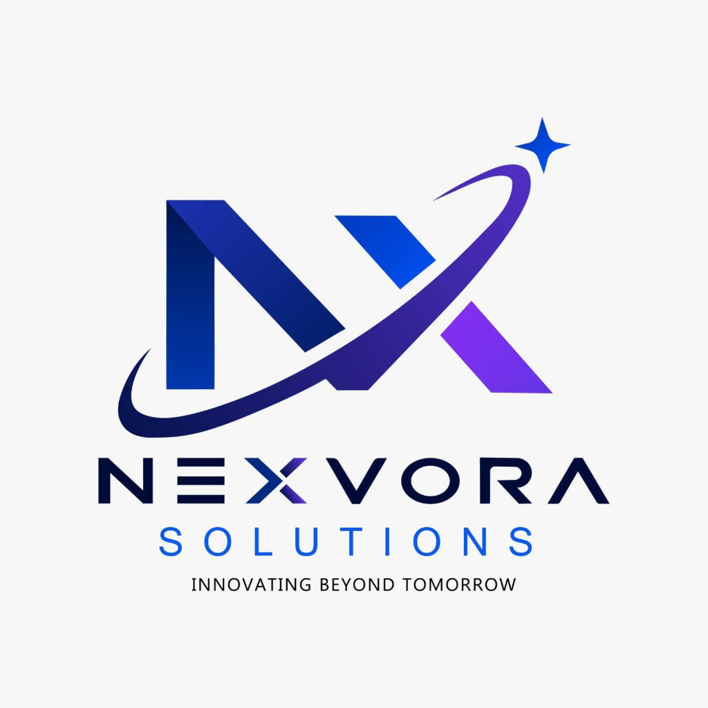

# 🎥 NexvoraMeeting — Free Zoom Alternative

<div align="center">
  
  <h3>Nexvora Solutions • Innovating Beyond Tomorrow</h3>
  <p>Production-ready Video Conferencing & Online Classroom Web Platform</p>
</div>

---

## 🚀 Live Access & Quick Start

The platform is running live at:
- **Application URL:** [http://localhost:5000](http://localhost:5000)

### 🔑 Demo Accounts (1-Click or Manual Login)
| Role | Email | Password | Features |
|---|---|---|---|
| **Admin** | `admin@nexvora.com` | `admin123` | Full Admin Console, User moderation, Usage statistics, Reports |
| **Host / Lecturer** | `teacher@nexvora.com` | `demo123` | Class scheduling, Waiting room moderation, Mute all, Whiteboard |
| **Google Sign-In** | Any | 1-Click / Real OAuth | Real Google Identity Services or 1-click onboarding |

---

## 🍃 MongoDB Database Configuration

The application includes direct support for **MongoDB** via Mongoose models:
- `User` (`server/models/User.js`)
- `Meeting` (`server/models/Meeting.js`)
- `MeetingHistory` (`server/models/MeetingHistory.js`)
- `Report` (`server/models/Report.js`)

### To connect your own MongoDB database:
1. Open the `.env` file in the project root:
   ```env
   # Local MongoDB:
   MONGODB_URI=mongodb://127.0.0.1:27017/nexvorameeting

   # Or MongoDB Atlas (Cloud Database):
   MONGODB_URI=mongodb+srv://<username>:<password>@cluster0.mongodb.net/nexvorameeting?retryWrites=true&w=majority
   ```
2. When the server starts:
   - If MongoDB is available, it connects automatically and seeds the initial admin and teacher profiles.
   - If MongoDB is not yet running, it automatically falls back to the resilient local JSON database (`server/data/db.json`), ensuring **zero downtime** and that the app works instantly out-of-the-box!

---

## 🌐 Google OAuth 2.0 Configuration

The application supports both Google Identity Services (GIS) button and 1-Click instant sign-in:
1. Create a Web OAuth Client ID in [Google Cloud Console](https://console.cloud.google.com/apis/credentials).
2. Set Authorized JavaScript Origins to: `http://localhost:5000`
3. Add your Client ID to `.env`:
   ```env
   GOOGLE_CLIENT_ID=your-google-client-id.apps.googleusercontent.com
   ```

---

## ✨ Features Implemented

### 1. Video Meeting Features
- **Official Branding:** Integrated Nexvora Solutions logo in navigation, favicon, modals, and video room.
- **Create Meeting:** Instant room creation (`nex-XXX-XXX`) or scheduled meetings.
- **Join Meeting:** Join by direct link (`http://localhost:5000/?meeting=nex-XXX-XXX`) or Meeting ID code.
- **HD Video Calling:** 360p (SD), 720p (HD), and 1080p (Full HD) resolution with camera switching and device test.
- **Audio Calling:** Microphone input selection, speaker device output test chime.
- **Quick Controls:** 1-click Mute / Unmute, Camera On / Off with status indicators.
- **Participants List:** Live attendee drawer with role badges (Host, Co-host, You) and audio/video state.
- **Share & Invite:** One-click copy invitation link, WhatsApp sharing, and Email invitations.
- **Waiting Room & Host Approval:** Hold participants until the host admits them individually or admits all at once.
- **Meeting Password & Security:** Optional passcode protection and meeting lock.

### 2. Screen Sharing & Online Classes
- **Screen Sharing:** Full screen, application window, or browser tab sharing using `navigator.mediaDevices.getDisplayMedia`.
- **Interactive Whiteboard:** Collaborative drawing canvas with pen, highlighter, eraser, multi-color palette, clear board, and instant screenshot download for notes.
- **Live Text Chat:** In-meeting discussion with public messages ("Everyone") and private Direct Messages between participants.
- **Raise Hand:** Visual hand badge, top notification banner, and host alert chime.
- **Emoji Reactions:** Floating emoji stream (👍, 👏, ❤️, 🎉, 😮, 😂, 🚀) floating smoothly over the video feed.
- **Full-Screen Mode:** Distraction-free full-screen meeting mode.
- **Responsive Browser Support:** Seamlessly works on Desktop, Tablets, and Mobile Chrome/Safari.

### 3. User Accounts & Dashboard
- **Authentication:** JWT-based secure Register / Login / Logout.
- **Google Sign-In:** Real Google Identity Services (GIS) OAuth + 1-click simulator.
- **User Profile:** Custom profile picture, display name, and device preferences.
- **Instant Meetings:** "New Meeting" one-click room launch.
- **Schedule Future Meetings:** Meeting title, date/time, duration, passcode, and waiting room settings.
- **Upcoming Meetings List:** Real-time countdown, start button, copy invite, and cancel controls.
- **Meeting History:** Past hosted classes with date, duration, and attendee count.
- **Personal Meeting Link (PMI):** Permanent, dedicated personal meeting room ID (e.g., `888-777-666`).
- **Dark Mode & Light Mode:** Sleek modern Zoom-inspired slate theme with high contrast support.

### 4. Host & Admin Features
- **Host / Co-host Permissions:** Promote participants to co-host with moderation privileges.
- **Mute Controls:** Host can mute individual attendees or trigger **"Mute All"**.
- **Remove Participants:** Host can kick disruptive attendees with reason notice.
- **Lock Meeting:** Prevents any new participants from entering once a session has begun.
- **Waiting Room Management Drawer:** Live pending participants list with "Admit", "Admit All", and "Deny" buttons.
- **Participant Permission Toggles:** Host can enable/disable screen sharing, in-meeting chat, and attendee unmute rights.
- **Admin Dashboard (`/admin`):**
  - Registered user directory with block/unblock, role promotion, and deletion.
  - Abuse and inappropriate behavior incident logs with review statuses.
  - Platform usage statistics (Total users, active meetings, total hours, weekly traffic charts).

---

## 💻 Commands to Run

```bash
# Start the full application (http://localhost:5000):
npm start

# Rebuild frontend assets:
npm run build
```
